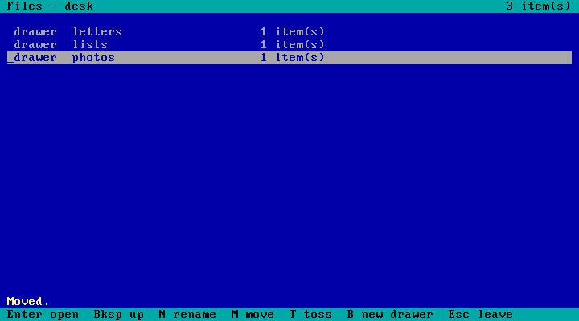

# Unseen OS

**A 20 KB operating system no AI has ever seen, built to test whether small AI models can
operate an unfamiliar computer, and whether reading the manual helps.**

Unseen OS is a tiny x86-64 operating system written in Rust. It boots in QEMU and has its own
vocabulary on purpose: folders are *drawers*, files are *pages*, the top drawer is the *desk*,
paths use `:` and saving in the editor is Ctrl+K. Because it didn't exist before November 2026,
no model has it in its training data. A model has to figure it out from the screen.



## The experiment

Two small models, **Claude Haiku** and **GPT Luna**, each played **30 tasks** (10 easy, 10
medium, 10 hard), once **without** and once **with** the [manual](docs/manual.md): 120 games.
They could only look at the 80x25 text screen and press keys, at most 40 actions per game.
Each game was scored on the real end state of the OS's files, never on what the model claimed.

The rules (test, decision rule, what counts as cheating) were written down and the files
frozen **before** any game with the manual was played: see [PREREG.md](PREREG.md).

### Results

| | Without manual | With manual |
|---|---|---|
| **Official score** (pre-registered rules) | Haiku 20/30 · Luna 27/30 | Haiku 28/30 · Luna 29/30 |
| Score counting only real cheating *(exploratory)* | Haiku 28/30 · Luna 29/30 | Haiku 30/30 · Luna 29/30 |
| Median actions, tasks won in both *(exploratory)* | Haiku 18 · Luna 16.5 | Haiku 13 · Luna 13 |

**Pre-registered verdict: "The manual helps"** (exact McNemar test over 60 task pairs:
12 pairs won only with the manual, 2 only without, p = 0.013; task-level check p = 0.039).

**Important caveat:** this verdict is driven by the audit. Any command other than a plain call of
the game tool counted as a loss. 15 games were flagged, 12 of them without the manual, and 14 of
the 15 were harmless shell habits (mostly Haiku writing `cd . && python play.py ...`). Only one
was real tool misuse (Luna called Codex's built-in computer-use tool once). Counting only real
misuse, success is near the ceiling in both conditions and the difference is not significant
(3 vs 1 pairs, p = 0.63).

**What holds up most clearly** *(exploratory)*: the manual made both models **faster**. Among tasks
won in both conditions, the manual version needed fewer actions in 47 of the 49 pairs where the
count differed: about 25-30% fewer actions.

**Takeaways**

1. Small models can operate a computer they have never seen: 28-30 of 30 tasks solved, by reading
   the screen, typing `guide` and exploring.
2. A manual mostly saves effort rather than turning failures into successes.
3. How you define cheating can decide a verdict. Our own pre-registered audit was stricter than
   intended, and that is what produced the official "helps" verdict.

Full numbers: [out/experiment/results.json](out/experiment/results.json). Inspect logs with every
step of every game: `out/experiment/logs/` (open with `inspect view --log-dir out/experiment/logs`).

### Honest notes

- One game per cell; no placebo (length-matched) control. See *Limitations* in PREREG.md.
- 6 pilot games were played while building the harness; they are listed in PREREG.md and the
  result also holds without the 2 pilot tasks (p = 0.023).
- Two start attempts failed before any game was scored (a path format error, then a clean-up bug
  that killed the OS before scoring). Both are documented in PREREG.md; the experiment was
  restarted from scratch with a new freeze each time.
- The harness was reviewed three times by a second model (GPT Sol) before launch; 27 issues were
  found and fixed (leaks, too-lenient checks, race conditions, analysis loopholes).

## How it works

```
 AI player ──► play.py ──► referee (broker.py) ──► QEMU ──► Unseen OS
 (Haiku/Luna)  look/type/   token, 1 action at a     keyboard    shell, Notes, Files,
               press only   time, limits, audit      + inspector in-memory file system
```

- **The OS** (`kernel/`): multiboot start-up code that switches the CPU to 64-bit mode, a VGA text
  screen, a polled PS/2 keyboard, an in-memory file system, a shell with 20 commands, a text
  editor (Notes) and a file manager (Files). A hidden serial "inspector" lets the harness read the
  screen as text and dump all files for scoring.
- **The referee** (`tools/broker.py`) is the only thing connected to the OS. The player's folder
  holds nothing but the game tool and a secret token, and every player command is audited.
- **The tasks** (`tools/tasks.py`): each has start files, a plain-words request, and a reference
  solution. `tools/validate_tasks.py` proves every task is solvable and that the strict scorer
  rejects 244 planted mistakes.
- **The harness** is [Inspect](https://inspect.aisi.org.uk/) (`tools/inspect_eval.py`).

## Run it yourself (Windows)

Needs Rust, QEMU (`C:\Program Files\qemu`) and Python 3.12 with `inspect-ai`.

```powershell
.\run.ps1                                  # build the OS and open it in a QEMU window
python tools/validate_tasks.py             # prove all 30 tasks are fair
inspect eval tools/inspect_eval.py -T player=robot -T conditions=plain,manual --model mockllm/model
python tools/run_task.py copy-list haiku   # one real game (needs the claude CLI)
```

Built in one day (4 Nov 2026) by Yentl Peck, directing Claude Opus (builder) and GPT Sol (reviewer).
