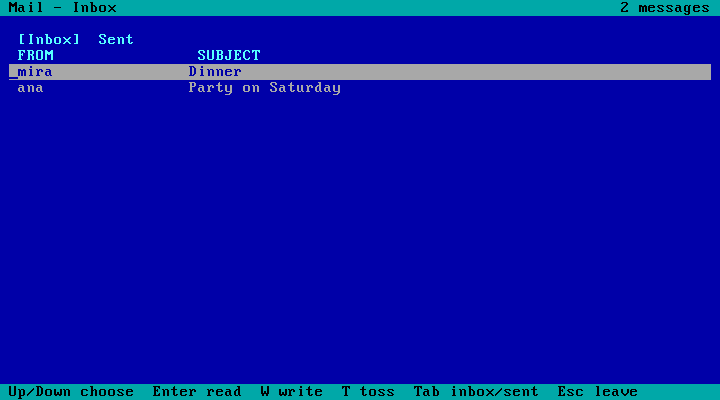

# Unseen OS

## Written by Yentl

*(Your own words go here: why you built this, what surprised you, what you would do next.)*

## Written by Claude

**A tiny operating system no AI has ever seen, built to test whether small AI models can
operate an unfamiliar computer, and whether reading the manual helps.**

Unseen OS is a small x86-64 operating system written in Rust. It boots in QEMU and has its own
vocabulary on purpose: folders are *drawers*, files are *pages*, the top drawer is the *desk*,
paths use `:` and saving is Ctrl+K. Because it didn't exist before November 2026, no model has
it in its training data. A model has to figure it out from the screen.

Version 0.3 has eight apps: a shell, **Notes**, **Files**, **Mail**, **Contacts**, **Calendar**,
**Settings** and a **Calculator**, plus **chores**: a tiny scripting language of its own. Later
it gained **Unseen Script**, a full programming language for building full-screen apps (state,
`start`, `key`, `draw`, modules and tests), and **stamps**: version history for the desk.

**Status: finished (8 Nov 2026).** Five pre-registered experiments, 1,704 scored games.



### Five experiments

| | Experiment 1 (v0.1) | Experiment 2 (v0.2) | Experiment 3 (v0.3) | Experiment 4 (v0.3) | Experiment 5 (Unseen Script) |
|---|---|---|---|---|---|
| Apps | shell, Notes, Files | + Mail, Contacts, Calendar, Settings, Calculator | + chores (scripting) | same as experiment 3 | + Unseen Script apps |
| Tasks | 30 single-app tasks | 20 tasks, most needing 2-3 apps | 16 tasks too big to do by hand | the same 16 tasks | 24 programming tasks: build, extend or fix an app |
| Compared | manual vs nothing | manual vs nothing | manual vs nothing | manual vs the reference alone (and nothing) | manual vs nothing (and the reference alone) |
| Games | 120 | 240 | 192 | 576 | 576 |
| Pre-registered verdict | **The manual helps** (p = 0.013) | **No clear difference** (p = 1.0) | **The manual helps** (p = 0.0001) | **The manual helps more than the reference** (p = 0.003) | **The manual helps** (p = 0.0001) |
| What really happened | models nearly always won; the verdict came from the audit | models nearly always won, with or without the manual | without the manual, the big tasks were never solved | the reference alone did most of the work; the manual added about 20 points more | +10.9 points pass rate and 43% fewer actions in won games; no significant difference between manual and reference |

Experiments 1 and 2 showed that **small models can operate a computer they have never seen**,
and that on easy tasks a manual mostly makes them faster. Experiment 3 made the tasks hard enough
to need a program in a language that exists nowhere else, and there **the manual made the
difference between failing and succeeding**: wins went from 18/96 to 59/96. Experiment 4 asked
how much of that comes from simply having the language reference: **the reference alone lifted
wins from 45/192 to 103/192, and the full manual lifted them further to 141/192.** Experiment 5
moved to real programming: building, extending and fixing apps, graded by hidden tests like
SWE-bench. There **the manual helped again (+10.9 points)**. Unlike experiment 4, no significant
difference between the manual and the reference was detected.

### Experiment 5: the Unseen App Benchmark

**Question:** when small AI models must program for real in Unseen Script, how much does the
manual help?

The models get 24 tasks:

- **8 build:** write a new app from a spec.
- **8 feature:** add something to one of four existing apps (a shop list, scores, recipes, an
  agenda).
- **8 fix:** repair a bug in one of the four apps.

A game is won only if every **hidden test** passes in a fresh copy of the desk. The tests also
check that the app changed nothing it shouldn't, and the command audit must pass. There are
three conditions:

- **plain**: nothing in the prompt. The 255-line reference is on the computer (`guide script`).
- **reference**: the reference in the prompt.
- **manual**: the full 961-line manual in the prompt. It contains the reference word for word.

Each player played each task 4 times per condition: 2 x 24 x 3 x 4 = **576 games**, at most 250
actions and 45 minutes each. Rules frozen before the first game: [PREREG5.md](PREREG5.md). Plan,
pilot and calibration: [docs/benchmark-design.md](docs/benchmark-design.md),
[docs/pilot5.md](docs/pilot5.md), [docs/calibration5.md](docs/calibration5.md).

#### Results

| Wins | Plain | Reference | Manual |
|---|---|---|---|
| Haiku | 86/96 | 95/96 | 91/96 |
| Luna | 71/96 | 80/96 | 87/96 |
| Median actions in won games | Haiku 60 · Luna 55 | Haiku 35 · Luna 26 | Haiku 34 · Luna 27 |

**Pre-registered verdicts:**

- **Primary, pass rate, manual vs plain: "The manual helps."** D = +10.9 points over the 24
  tasks. Sign-flip test, p = 0.0001; 95% interval +6.2 to +15.7.
- **Key secondary, actions in won games: "The manual helps."** −43%, p < 0.0001; 95% interval
  −53% to −32%.

Also reported, without a verdict:

- **Reference vs plain:** +9.4 points (p = 0.002).
- **Manual vs reference:** +1.6 points (p = 0.63, 95% −2.9 to +6.3). No significant difference
  was detected.
- **By player, manual vs plain:**
  - Luna gained more: +16.7 points (p = 0.001).
  - Haiku gained less: +5.2 points (p = 0.125). It was already at 90% in plain.
- In 165 of 192 plain games, the player opened `guide script` and read the reference on screen.

Full results: [docs/results5.md](docs/results5.md). Analysis output:
[out/experiment5/analysis.txt](out/experiment5/analysis.txt). Every step of every game:
`inspect view --log-dir out/experiment5/logs`.

#### Honest notes

- **One analysis deviation.** The frozen analysis refused a verdict only because Inspect stored
  the `conditions` setting as a list instead of text. `tools/analyze5_d1.py` fixes just that one
  format and runs the frozen analysis unchanged. No result changes. Details:
  [docs/deviations5.md](docs/deviations5.md).
- **22 games failed the audit** and count as losses: 17 Luna, 5 Haiku. By condition: 11 plain,
  8 reference, 3 manual. Of these, 9, 8 and 1 had passed every hidden test, so part of the
  pass-rate gap comes from the command rule.
- **0 OS crashes, 0 time-outs.**
- **The run was paused overnight** (7 Nov 23:55 to 8 Nov 11:43) and resumed with `--retry`. 8
  games in progress were discarded and played again. 6 Luna games hit a Codex
  `max_output_tokens` error, all in plain, and got their registered re-run (4 won, 2 lost).
- Two small models and 24 tasks. Feature and fix tasks share four base apps, so tasks are not
  fully independent.
- The experimenter wrote the language, the tasks and the manual. Sol reviewed the tasks, the
  harness, the pre-registration and the results.

### Experiment 4: the full manual or just the reference?

The manual in experiment 3 holds the chore reference (the same text `guide do` shows on screen),
but also the OS chapters, extra explanations, five worked examples and tips. Experiment 4 asks
whether the full manual helps **more than the reference alone**. It reuses experiment 3's 16
tasks, world and players, with a third condition in between:

- **plain**: nothing in the prompt (the reference is still on the computer, `guide do`),
- **reference**: only the chore reference in the prompt (106 lines),
- **manual**: the full manual in the prompt, as in experiment 3.

Each player played each task **6 times per condition**: 2 x 16 x 3 x 6 = **576 games**, with the
three conditions mixed in random order. The harness was fixed first: keystrokes are now sent in
acknowledged batches (experiment 3 lost keys in long actions), and the audit allows a backslash in
the game tool's PowerShell arguments. Rules frozen before the first game: [PREREG4.md](PREREG4.md).
Design and Sol's reviews: [docs/v4-design.md](docs/v4-design.md).

#### Results

| Wins | Plain | Reference | Manual |
|---|---|---|---|
| Haiku | 16/96 | 42/96 | 68/96 |
| Luna | 29/96 | 61/96 | 73/96 |
| Median actions in won games *(not part of the verdict)* | Haiku 75.5 · Luna 46 | Haiku 67 · Luna 47 | Haiku 60 · Luna 39 |

| Task kind (both players) | Plain | Reference | Manual |
|---|---|---|---|
| count | 1/60 | 27/60 | 36/60 |
| bulk | 3/60 | 27/60 | 44/60 |
| fix | 28/36 | 28/36 | 33/36 |
| write | 13/36 | 21/36 | 28/36 |

**Pre-registered verdict: "The manual helps more than the reference."** The average per-task
difference in win rate is **D = +19.8 points** (permutation test over the 16 tasks, p = 0.003;
95% interval 9.2 to 30.6 points). 13 tasks scored better with the manual, 2 better with the
reference (`overdue` 5 -> 3 of 12, `write-birthdays` 10 -> 8 of 12), 1 tied.

Also reported, without a verdict:

| | Haiku | Luna | Both |
|---|---|---|---|
| manual vs reference | +27.1 points (p = 0.003) | +12.5 points (p = 0.08) | +19.8 points (p = 0.003) |
| reference vs plain | +27.1 points (p = 0.0006) | +33.3 points (p = 0.0007) | +30.2 points (p = 0.0003) |
| manual vs plain | +54.2 points (p = 0.0001) | +45.8 points (p = 0.001) | +50.0 points (p = 0.0001) |

- **Most of the manual's power is the reference.** Having the reference in the prompt took the
  count and bulk tasks from almost never solved (4/120) to 54/120. In the plain condition the
  models could read the same text on screen (about 40% of plain games opened `guide do`), but
  reading it 25 lines at a time worked far less well than having it up front.
- **The full manual still adds a lot, mainly for Haiku.** Haiku gained 26 wins from the manual
  over the reference; Luna gained 12, and Luna's difference on its own is not significant.
- **Part of the manual's lead comes from the audit.** Counting only whether the task got done
  (ignoring how commands were sent), the reference and manual are closer: Haiku 64 vs 74, Luna
  66 vs 73. With the reference, Haiku broke the command rules in 30 games and Luna in 8; with
  the manual, 13 and 0. *(Exploratory, not pre-registered.)*
- **Experiment 3 replicates.** Manual vs plain is again a large win (15 tasks better, 0 worse).
  Wins are higher than in experiment 3 in both conditions, probably helped by the keystroke fix.
- No game crashed the OS, and no fix or write game worked on the visible world but failed a
  hidden one.

| Task | Plain | Reference | Manual |
|---|---|---|---|
| biggest-invoice | 1/12 | 4/12 | 7/12 |
| contact-invoices | 0/12 | 4/12 | 8/12 |
| december-due | 0/12 | 6/12 | 8/12 |
| fix-hello | 10/12 | 8/12 | 10/12 |
| fix-late | 9/12 | 10/12 | 12/12 |
| fix-total | 9/12 | 10/12 | 11/12 |
| invite-neighbours | 1/12 | 5/12 | 11/12 |
| invoice-thanks | 0/12 | 4/12 | 8/12 |
| meeting-events | 0/12 | 7/12 | 12/12 |
| overdue | 0/12 | 5/12 | 3/12 |
| phonebook | 2/12 | 6/12 | 8/12 |
| reminders | 0/12 | 5/12 | 5/12 |
| weekend-due | 0/12 | 8/12 | 10/12 |
| write-birthdays | 6/12 | 10/12 | 8/12 |
| write-digest | 2/12 | 2/12 | 8/12 |
| write-stats | 5/12 | 9/12 | 12/12 |

Results: [out/experiment4/results.json](out/experiment4/results.json). Run notes:
[out/experiment4/RUN-NOTES.md](out/experiment4/RUN-NOTES.md). Every step of every game:
`inspect view --log-dir out/experiment4/logs`.

#### Honest notes

- **84 games failed the audit** and count as losses: Haiku 28 / 30 / 13 and Luna 5 / 8 / 0
  (plain / reference / manual).
- **8 games timed out** (15 minutes), all Luna, 5 of them on `write-digest`.
- **The run was paused overnight** (PC off, 5 Nov 23:40 to 6 Nov 10:26) and resumed with
  `--retry` under the written rules. **5 attempts were discarded** and played again: 4 games in
  progress at the pause, and 1 Luna game where the OS failed to handle a key at the final check
  (a harness error). All are listed in results.json.
- **Deviation: the Codex CLI updated itself** from 0.166.0 to 0.167.0 at 10:27 on 6 Nov, one
  minute after the resume, so Luna's later games ran on the new version (same model and
  arguments). Luna's wins before and after the pause look the same: plain 7/26 vs 22/70,
  reference 15/23 vs 46/73, manual 18/23 vs 55/73. Claude Code updated to 2.1.319 only after
  Haiku's last game.
- **Package comparisons.** "manual vs reference" bundles the OS chapters, extra explanations,
  worked examples, tips and length; there is no length-matched placebo. Same tasks, world and
  models as experiment 3, and the experimenter knew its results. The 5 count tasks all read
  invoice mails, so they are not independent of each other.
- Another project ran AI experiments with the same accounts on the same PC during the run.

### Experiment 3: writing code in an unseen language

Unseen OS 0.3 adds **chores**: small programs typed into a page and run with `do <page>`. The
language uses familiar ideas (variables, loops, conditions), but its syntax, built-ins and page
model are new. Its complete reference is on the computer itself (`guide do`).

```text
set total to 0
for each m in pages('mail:inbox')
  when field(m, 'subject') is 'Invoice'
    set total to total + number(item(words(body(m)), 2))
  done
done
write('desk:answer', total)
```

The world has 100 contacts, 400 mails, 30 sent mails and 150 events. Each of the **16 tasks**
needs at least 130 actions without a chore, but players get only 100:

- **5 count** tasks (for example, "how many invoices are due on a weekend?"),
- **5 bulk** tasks (send many mails, add many events, write a phone book),
- **3 fix** tasks (repair a broken chore and run it),
- **3 write** tasks (write a reusable chore and run it).

A fix or write game only wins if the player's chore *also* works on 3 hidden worlds it never saw
(different sizes, nothing to find, another date). As before, each task was played 3 times
without and 3 times with the manual. The manual holds the same reference word for word, plus
explanations and 5 worked examples. Rules frozen before the first game: [PREREG3.md](PREREG3.md).
Language design and reviews: [docs/v3-design.md](docs/v3-design.md).

#### Results

| | Without manual | With manual |
|---|---|---|
| Haiku wins | 5/48 | 25/48 |
| Luna wins | 13/48 | 34/48 |
| Median actions in won games *(not part of the verdict)* | Haiku 91 · Luna 47 | Haiku 51 · Luna 34.5 |

| Task kind (both players) | Without manual | With manual |
|---|---|---|
| count | 0/30 | 12/30 |
| bulk | 0/30 | 17/30 |
| fix | 11/18 | 15/18 |
| write | 7/18 | 15/18 |

**Pre-registered verdict: "The manual helps."** Per-task sign test: 15 tasks scored better with
the manual, none better without, 1 tied (p = 0.0001). The same holds for each player separately
(Haiku p = 0.0005, Luna p = 0.0002).

- **Without the manual, no count or bulk task was ever solved** (0 of 60 games). The models
  could find the reference on screen (`guide do`), but reading it 25 lines at a time and then
  writing a working chore didn't fit in 100 actions.
- **Fixing a chore is easier than writing one.** With a broken chore in front of them, the models
  won 11 of 18 fix games without the manual.
- No game crashed the OS, and no fix or write game worked on the visible world but failed a
  hidden one.

Results: [out/experiment3/results.json](out/experiment3/results.json). Every step of every game:
`inspect view --log-dir out/experiment3/logs`.

#### Honest notes

- **28 games failed the audit** and count as losses. 23 were Haiku, all real rule breaks
  (`$(...)`, `$'...'`, shell variables), in both conditions. 5 were Luna: 2 real (unquoted
  brackets and `&` in PowerShell). The other 3 (all without the manual) reached the correct end
  state but were refused only for a backslash in an unquoted word. PowerShell treats a backslash
  as an ordinary character, so these are arguably **audit false positives**. They stay losses
  under the frozen rules. Counted as wins, Luna would be 16/48 without the manual, and the
  verdict would not change (still 15 tasks to 0).
- **2 games timed out** (15 minutes). **5 attempts were discarded** and re-played under the rules
  because the OS lost keystrokes in long games (a harness error, not the player's fault). One
  game hit this twice and was re-played with `eval-retry`. All are listed in results.json.
- The 5 count tasks all read invoice mails, so they are not independent of each other.
- No placebo (length-matched) control: "manual" adds the reference in the prompt, worked examples
  and prompt length together. Without it, the reference was only on the screen.
- Calibration on 5 separate practice tasks found and fixed an audit bug before the experiment
  ([docs/calibration3.md](docs/calibration3.md)). GPT Sol reviewed the language, the tasks and the
  harness before freezing.
- Another project ran AI experiments with the same accounts on the same PC during the run.

### Experiment 2: multi-app tasks

Two small models, **Claude Haiku** and **GPT Luna**, played **20 tasks** that need several apps
together (e.g. "Lina asked to move a lesson (see your mail). Change it in the calendar, then reply
to Lina with the new date."). Each task was played **3 times without and 3 times with** the
[manual](docs/manual.md): 240 games, at most 60 actions each. Players could only look at the
80x25 text screen and press keys. Every game was scored on the real end state of the OS's files.

The rules were written down and all files frozen (SHA-256 manifest) **before** the first game:
see [PREREG2.md](PREREG2.md).

#### Results

| | Without manual | With manual |
|---|---|---|
| Haiku wins | 59/60 | 58/60 |
| Luna wins | 59/60 | 58/60 |
| Median actions in won games *(not part of the verdict)* | Haiku 29 · Luna 22 | Haiku 19 · Luna 14.5 |

**Pre-registered verdict: "No clear difference."** Per-task sign test: 1 task scored better with
the manual, 2 better without, 17 tied (p = 1.0). The same holds for each player separately.

Only 6 of 240 games were lost:

- **4 failed the audit** (the player used shell features the rules don't allow, such as
  `$(printf ...)` or a PowerShell wrapper with nested quotes). All 4 are listed in
  [results.json](out/experiment2/results.json).
- **2 were real mistakes, and both were the same mistake.** In `move-lesson` (with the manual),
  Haiku and Luna both pressed R to reply, then pressed Tab twice to get from "To" to the
  message. But a reply starts with the cursor *already in the message*, and the text screen shows
  no cursor. So both models typed their reply into the To or Subject field. The manual didn't
  say where a reply starts. **A hidden piece of screen state tripped up two different models in
  exactly the same way**, which is the most useful finding of this run for anyone building
  agent-friendly interfaces.

No game timed out and no game needed a harness re-run. Results:
[out/experiment2/results.json](out/experiment2/results.json). Every step of every game:
`inspect view --log-dir out/experiment2/logs`.

#### Honest notes

- **Ceiling effect:** 97.5% of games were won in both conditions, so this experiment could not
  show a benefit on success even if one exists. Harder tasks are the next step (see below).
- **Pause:** the run was paused overnight on purpose (the PC was switched off) and resumed with
  Inspect `eval-retry`, as PREREG2 allows. 71 Luna games were finished and kept; the 2 games in
  progress were never scored and were played again. Details:
  [RUN-NOTES.md](out/experiment2/RUN-NOTES.md).
- During the second half, another experiment (a different project, also using Haiku and Luna) ran
  on the same PC.
- No placebo (length-matched) control: "manual" adds information and prompt length together.
- The harness was reviewed three times by a second model (GPT Sol) before launch, and every issue
  found was fixed before freezing.

### Experiment 1: single-app tasks

Haiku and Luna each played **30 tasks** (10 easy, 10 medium, 10 hard) in Notes, Files and the
shell, once without and once with the manual: 120 games, at most 40 actions each. Rules:
[PREREG.md](PREREG.md).

| | Without manual | With manual |
|---|---|---|
| **Official score** (pre-registered rules) | Haiku 20/30 · Luna 27/30 | Haiku 28/30 · Luna 29/30 |
| Score counting only real cheating *(exploratory)* | Haiku 28/30 · Luna 29/30 | Haiku 30/30 · Luna 29/30 |
| Median actions, tasks won in both *(exploratory)* | Haiku 18 · Luna 16.5 | Haiku 13 · Luna 13 |

**Pre-registered verdict: "The manual helps"** (exact McNemar test over 60 task pairs:
12 pairs won only with the manual, 2 only without, p = 0.013; task-level check p = 0.039).

**Important caveat:** this verdict is driven by the audit. Any command other than a plain call of
the game tool counted as a loss. 15 games were flagged, 12 of them without the manual, and 14 of
the 15 were harmless shell habits (mostly Haiku writing `cd . && python play.py ...`). Only one
was real tool misuse (Luna called Codex's built-in computer-use tool once). Counting only real
misuse, the difference is not significant (3 vs 1 pairs, p = 0.63). Experiment 2 used a fairer
audit that was written down in advance.

**What holds up most clearly** *(exploratory)*: among tasks won in both conditions, the manual
version needed fewer actions in 47 of the 49 pairs where the count differed.

Results: [out/experiment/results.json](out/experiment/results.json). Logs: `out/experiment/logs/`.

#### Honest notes (experiment 1)

- One game per cell; no placebo control. See *Limitations* in PREREG.md.
- 6 pilot games were played while building the harness; they are listed in PREREG.md and the
  result also holds without the 2 pilot tasks (p = 0.023).
- Two start attempts failed before any game was scored (a path format error, then a clean-up bug
  that killed the OS before scoring). Both are documented in PREREG.md; the experiment was
  restarted from scratch with a new freeze each time.
- **Players were not fully isolated.** Haiku ran with the owner's Claude Code plugins loaded,
  including a memory plugin (claude-mem) that added the same start-up text to all 60 Haiku games.
  That text contained no task words, but it is extra context we did not intend. Luna had Codex's
  computer-use tool available. Both were fixed for experiment 2: every game runs from a fresh,
  empty setup folder that holds only the login.

### How it works

```
 AI player ──► play.py ──► referee (broker.py) ──► QEMU ──► Unseen OS
 (Haiku/Luna)  look/type/   token, 1 action at a     keyboard    shell + 7 apps,
               press only   time, limits, audit      + inspector in-memory file system
```

- **The OS** (`kernel/`): multiboot start-up code that switches the CPU to 64-bit mode, a VGA text
  screen, a polled PS/2 keyboard, an in-memory file system, a shell and seven apps built on a
  small shared UI kit (`ui.rs`: text fields, forms, lists). A hidden serial "inspector" lets the
  harness read the screen as text and dump all files for scoring.
- **The referee** (`tools/broker.py`) is the only thing connected to the OS. The player's folder
  holds nothing but the game tool and a secret token, and every player command is audited
  (`tools/audit.py`, with its own allowed/rejected test cases).
- **The tasks** (`tools/tasks.py`, `tools/tasks_v2.py`): each has start files, a plain-words
  request, a reference solution, and right and wrong example answers.
  `tools/validate_tasks.py` proves every task is solvable and that the strict scorer catches
  planted mistakes.
- **Chores** (`kernel/src/chore.rs`): a tokenizer, parser and interpreter in `no_std` Rust, with
  hard limits on steps, text, lists and depth. A chore's changes apply all at once, and only if
  it succeeds. Host tests (`chore-tests/`) include 40,000 fuzzed programs.
- **Unseen Script** (`script/`): a lexer, parser, checker and interpreter in `no_std` Rust, with
  modules, a test runner (`test`) and full-screen apps (`start`, `key`, `draw`). The OS runs it,
  and `script/tests/` runs it on the PC. Design: [docs/script-design.md](docs/script-design.md).
- **The harness** is [Inspect](https://inspect.aisi.org.uk/) (`tools/inspect_eval.py`, and
  `tools/inspect_apps.py` for experiment 5), with an append-only ledger of every attempt and
  frozen-file checks before running and analysing.

### Run it yourself (Windows)

Needs Rust, QEMU (`C:\Program Files\qemu`) and Python 3.12 with `inspect-ai`.

```powershell
.\run.ps1                                  # build the OS and open it in a QEMU window
python tools/validate_tasks.py             # prove all tasks are fair
inspect eval tools/inspect_eval.py -T player=robot -T taskset=v2 --model mockllm/model
git checkout experiment-5                  # each experiment's exact state is a git tag
python tools/analyze5_d1.py                # re-check experiment 5's verdict from the logs
```

The analysis scripts refuse to run if any frozen file changed, so re-check an experiment from its
own tag (`experiment-1` to `experiment-5`): later versions of the harness change
shared files.

Built 4-8 Nov 2026 by Yentl Peck, directing Claude Opus (builder) and GPT Sol (reviewer).

License: MIT (see [LICENSE](LICENSE)); bundled crates are listed in [THIRD-PARTY-NOTICES.md](THIRD-PARTY-NOTICES.md).
